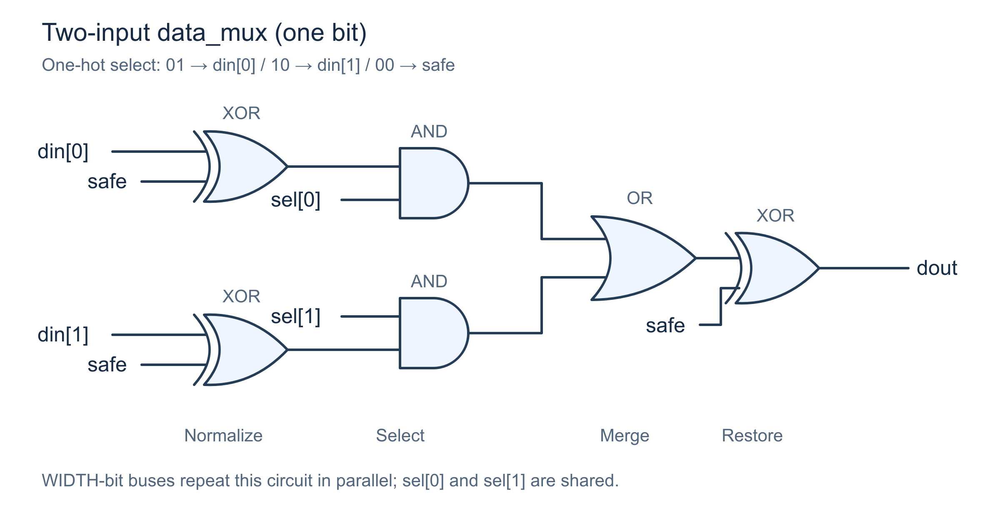
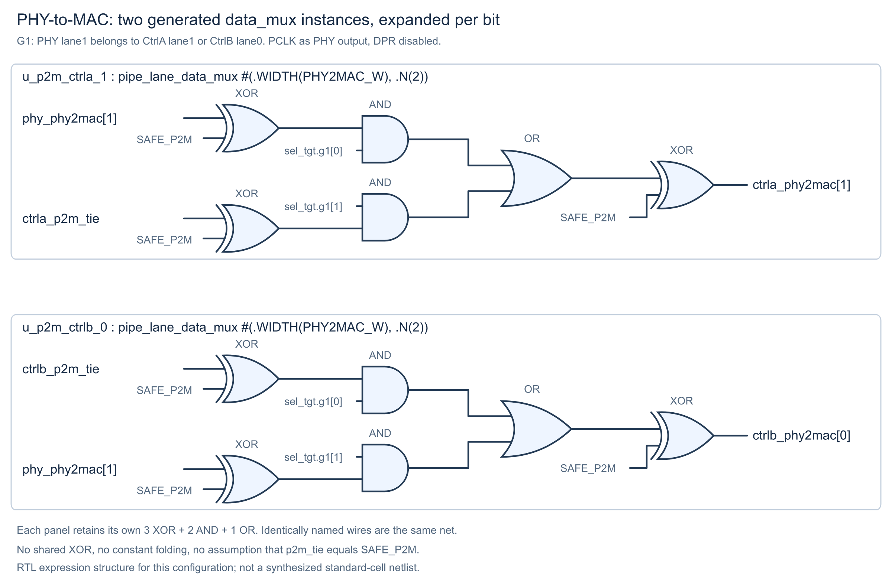

# data_mux 真值表与 PHY→MAC 回传电路

## Two-input data_mux 真值表

对应 `src/plm/core/common/pipe_lane_data_mux.sv`，取 `N=2`、`WIDTH=1`。
右侧四列都是 `dout`，覆盖全部 32 组二值输入组合：

| `safe` | `din[0]` | `din[1]` | `sel=00` | `sel=01` | `sel=10` | `sel=11`（非法） |
|:---:|:---:|:---:|:---:|:---:|:---:|:---:|
| 0 | 0 | 0 | 0 | 0 | 0 | 0 |
| 0 | 0 | 1 | 0 | 0 | 1 | 1 |
| 0 | 1 | 0 | 0 | 1 | 0 | 1 |
| 0 | 1 | 1 | 0 | 1 | 1 | 1 |
| 1 | 0 | 0 | 1 | 0 | 0 | 0 |
| 1 | 0 | 1 | 1 | 0 | 1 | 0 |
| 1 | 1 | 0 | 1 | 1 | 0 | 0 |
| 1 | 1 | 1 | 1 | 1 | 1 | 1 |

- `00`：输出 `safe`；`01`：输出 `din[0]`；`10`：输出 `din[1]`。
- `11` 违反 one-hot 约束。表中给出组合表达式的实际计算结果，不是合法工作状态。
- 多位数据按位应用此表，共用同一组 `sel`；表中不包含 X/Z。

```text
dout = (((din[0] XOR safe) AND sel[0])
     OR ((din[1] XOR safe) AND sel[1])) XOR safe
```



[SVG 原图](images/pipe_lane_data_mux.svg)。图中的每个输入 XOR、选择 AND、合并 OR
和输出 XOR 均对应 common 模块的组合表达式；未进行常量折叠。

## data_demux：按实际生成实例展开

当前 RTL 没有独立的 `pipe_lane_data_demux` 模块。PHY→MAC 路由由
`gen_data_p2m()` 为各 controller 输出实例化 `pipe_lane_data_mux`。
下图展开两个完整实例，没有把它们改画成共享 XOR 的等效 demux。

例子取 `pclk_as_phy_output`、DPR 关闭，两种 mode 的归属如下：

| mode | PHY lane0 | PHY lane1 |
|---|---|---|
| 0 | CtrlA lane0 | CtrlA lane1 |
| 1 | CtrlA lane0 | CtrlB lane0 |

CtrlA 的宽度为 2，CtrlB 的宽度为 1。lane1 为 G1，候选顺序为 CtrlA、CtrlB。
生成器为 CtrlA lane1 和 CtrlB lane0 实际输出以下实例：

```systemverilog
pipe_lane_data_mux #(.WIDTH(PHY2MAC_W), .N(2)) u_p2m_ctrla_1 (
    .sel  (sel_tgt.g1),
    .din  ({ctrla_p2m_tie, phy_phy2mac[1]}),
    .safe (SAFE_P2M),
    .dout (ctrla_phy2mac[1])
);
pipe_lane_data_mux #(.WIDTH(PHY2MAC_W), .N(2)) u_p2m_ctrlb_0 (
    .sel  (sel_tgt.g1),
    .din  ({phy_phy2mac[1], ctrlb_p2m_tie}),
    .safe (SAFE_P2M),
    .dout (ctrlb_phy2mac[0])
);
```

拼接最右侧对应 `din[0]`。两路输出的连接关系是：

| 实例 | `din[0]` | `din[1]` | `.safe` |
|---|---|---|---|
| `u_p2m_ctrla_1` | `phy_phy2mac[1]` | `ctrla_p2m_tie` | `SAFE_P2M` |
| `u_p2m_ctrlb_0` | `ctrlb_p2m_tie` | `phy_phy2mac[1]` | `SAFE_P2M` |



[SVG 原图](images/pipe_lane_data_demux.svg)。每个面板对应上面一个实际实例，按单个
数据位展开；分别保留三个 XOR、两个 AND、一个 OR。图中同名网络电气相连，
两个实例的门电路各自独立，没有共享输入 XOR，也没有删除未选 owner 的 tie 分支。
这是生成 RTL 的组合运算结构，不代表综合工具优化后的 standard-cell 网表。

| `sel_tgt.g1` | `ctrla_phy2mac[1]` | `ctrlb_phy2mac[0]` |
|:---:|---|---|
| `01` | `phy_phy2mac[1]` | `ctrlb_p2m_tie` |
| `10` | `ctrla_p2m_tie` | `phy_phy2mac[1]` |
| `00` | `SAFE_P2M` | `SAFE_P2M` |

`SAFE_P2M` 根据 `safe_state` 拼接；`*_p2m_tie` 根据各信号的 `tie_off` 生成。
两者不要求相等，`tie_off=lane0` 的字段可以跟随 controller 固定 base lane 的实时值。
因此，tie 输入与 `SAFE_P2M` 之间的 XOR 必须保留，不能假设该分支恒为 0。

本图针对上述两候选配置。其他拓扑的候选数、映射和实例数按实际配置变化；
DPR 与 PHY-input 时钟架构的选择来源也按生成器变化，不能直接套用本例端口连接。
