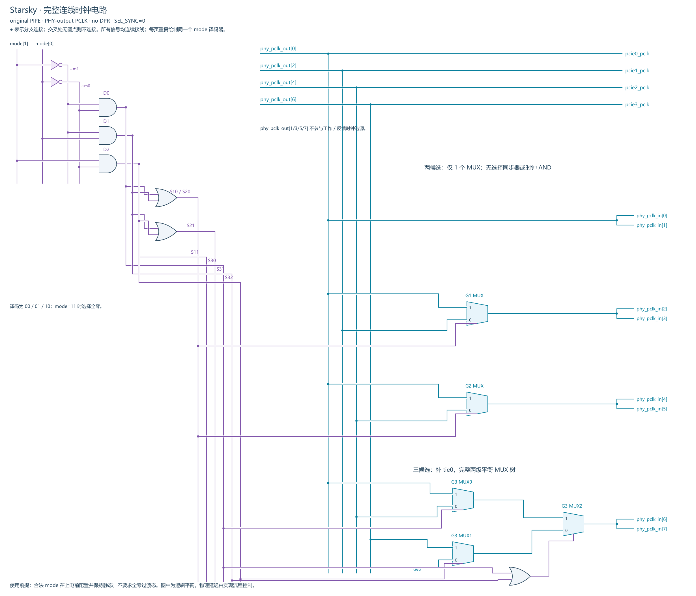
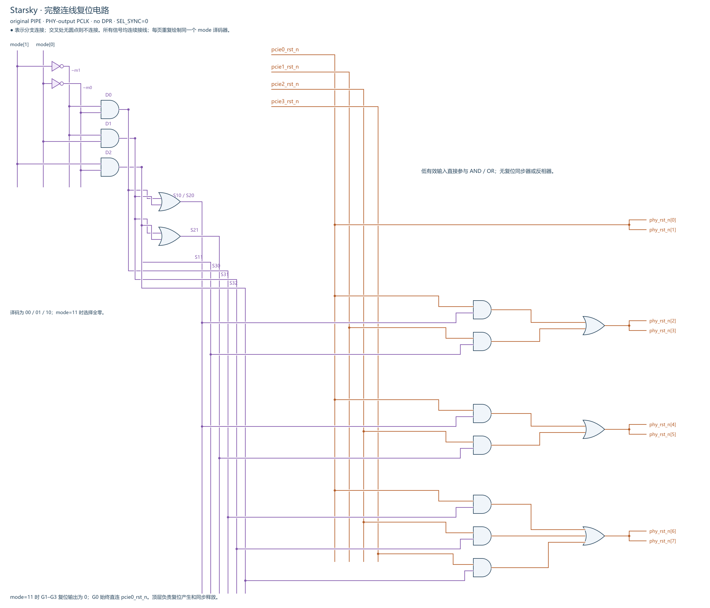

# Starsky original PIPE / 无 DPR

2026-11-17 本地生成，PLM 3.0.7。按用户更新的 `config/gen_flags.txt`：
`arch=original_pipe`、`pclk-mode=pclk_as_phy_output`，不启用 DPR。
先前的 SerDes 交付已被本次生成结果替换；以当前 manifest 为准。

| mode | lane0–1 | lane2–3 | lane4–5 | lane6–7 |
| --- | --- | --- | --- | --- |
| 0 | pcie0[1:0] | pcie0[3:2] | pcie0[5:4] | pcie0[7:6] |
| 1 | pcie0[1:0] | pcie0[3:2] | pcie2[1:0] | pcie2[3:2] |
| 2 | pcie0[1:0] | pcie1[1:0] | pcie2[1:0] | pcie3[1:0] |

从仓库根目录重现（CLI 不读取 gen_flags，故显式传参）：

```powershell
uv run plm validate --config examples/starsky/config
uv run plm generate --config examples/starsky/config --arch original_pipe --pclk-mode pclk_as_phy_output
uv run python examples/starsky/docs/draw_clock_reset.py
```

本次正常替换目录时遇到 Windows 目录占用，实际通过相同生成服务写入
`verification/original_pipe/rtl` 和 `tb`，再完整复制到本目录的 `rtl/` 和 `tb/`。
生成输出文件以 `rtl/manifest.json`、`tb/manifest.json` 中的 SHA256 为准。

RTL 清单：[rtl/flist.f](rtl/flist.f)。主模块：
[pipe_lane_mapper.sv](rtl/src/pipe_lane_mapper.sv)。逐信号接口 wrapper：
[pipe_lane_mapper_connection.sv](rtl/src/pipe_lane_mapper_connection.sv)。

## 逻辑门级时钟复位图





[时钟 SVG](docs/clock_connected.svg)、[复位 SVG](docs/reset_connected.svg)、
[合并 SVG](docs/clock_reset.svg)。图中展开 mode 的 NOT/AND/OR 译码、
实际平衡时钟 MUX 树和复位 AND/OR 网络，每页均从输入到输出完整连线。
这是生成 RTL 的逻辑展开，尚未做工艺库映射，不代表 DC 映射后的具体标准单元。
分支连接以圆点表示，交叉而无圆点则不连接，不使用同名标签代替实际导线。
组输出的两条 lane 均单独画出连接。

- pcie0/1/2/3 的标量 pclk 固定取自 phy_pclk_out[0/2/4/6]，不随 mode 改变。
- G0 反馈时钟直连 pcie0_pclk；G1/G2 各用一个组合 MUX，没有时钟 AND。
  G3 将三个时钟补齐一个 tie0，以三个 MUX 构成完整两级平衡树。
  生成器对 6/12 候选同样补齐到 8/16 叶子，形成 3/4 级完整树。
  每个节点按左子树选择位 OR 决定归属。本场景仅使用合法静态 mode。
  保留补零 MUX 的 RTL 结构不等于保证综合后保留该单元；物理平衡需结合工艺单元映射及实现约束。
- pcie*_rst_n 按 owner 经 AND/OR 选择至 phy_rst_n。G0 直连 pcie0_rst_n。
- 此架构没有 SerDes 的 perst_n、rx_clk，也没有 DPR。
- mode 在上电前配置为合法值，运行期间保持静态。sel_tgt 直接连接组合译码，
  不例化选择同步器，不添加全零过渡态保护；非法 mode 的时钟输出不作为接口保证。
- 以上改动仅适用于 original PIPE / 无 DPR / PCLK as PHY output。
  SerDes、PCLK as PHY input、所有 DPR 路径与修改前生成内容逐字比较一致。

## DC subdesign：仅时钟与复位

使用 [constraints/pipe_lane_mapper.sdc](constraints/pipe_lane_mapper.sdc)。
在顶层已 link、已建立上游时钟后，保持顶层设计和实例作用域：

```tcl
set PLM_INSTANCE u_soc/u_pipe_lane_mapper ;# 改成真实层级实例路径
source /absolute/path/to/starsky/constraints/pipe_lane_mapper.sdc
```

若用 connection wrapper，路径应指向其内部的实际 pipe_lane_mapper 实例。
脚本从实例的 phy_pclk_out 输入 pin 查询已经到达的上游时钟，建立控制器 pclk
和反馈时钟输出上的 1:1 generated clock；只把同一反馈输出的不同 owner 时钟
设为逻辑互斥。顶层负责源时钟周期、uncertainty、latency、异步关系等。
脚本不会重复 create_clock，也不修改 current_design/current_instance。
脚本应在源时钟可沿层级传播后加载；若输入 pin 上没有时钟会直接报错。

复位仅是组合网络，没有本地复位触发器，因此不需要局部复位时序例外。
不对复位做 blanket false_path 或 case_analysis，以保留顶层下游复位传播及
recovery/removal 分析；确有需要的异步复位例外应按顶层复位方法学施加到实际接收端。

已移除先前独立综合脚本、演示周期、数据路径和 IO 预算。mode 在综合时保持可变，
固定 mode 的 case analysis 由顶层独立 STA 场景设置。

## 实际验证

- 修改后的配置校验通过；manifest 确认 original_pipe / pclk_as_phy_output / dpr=false。
- 本次 original PIPE RTL 已由 Verilator 5.50 重新编译并运行自检 TB：
  [simulation_original_pipe.log](verification/simulation_original_pipe.log) 中
  `TB_RESULT: PASS`，clock/reset/m2p/p2m/tie_off/safe_state 均为 0 errors。
- `verification/compile_original_pipe.log` 保存本次编译输出。
  旧的 `compile.log` / `simulation.log` 是先前 SerDes 运行记录，不用于证明当前版本。
- 门级图已实际渲染 PNG 并检查布局与文字。
- 静态 mode 修订后：45 项核心测试、5 项生成回归、2 项组合时钟仿真通过；
  Starsky 本次自检 `TB_RESULT: PASS`。已确认时钟路由无 AND，sel_tgt 直接组合连接。
- 平衡树专项 Verilator 回归通过：3/6/12 路分别覆盖 4096 种选择与 16 种时钟
  输入电平；保留全零安全输出及多选时低索引优先。相关记录位于
  `verification/balanced_tree_regression.log`。两架构组合时钟回归及 5 项生成回归通过。
- 本机没有 dc_shell，SDC 尚未经过真实 DC 层级对象解析或工艺库综合验证。

生成器改动随 PLM 3.0.7 提交；示例验证产物保留在本地 verification/。
